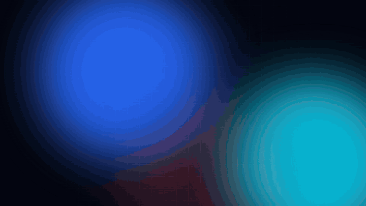
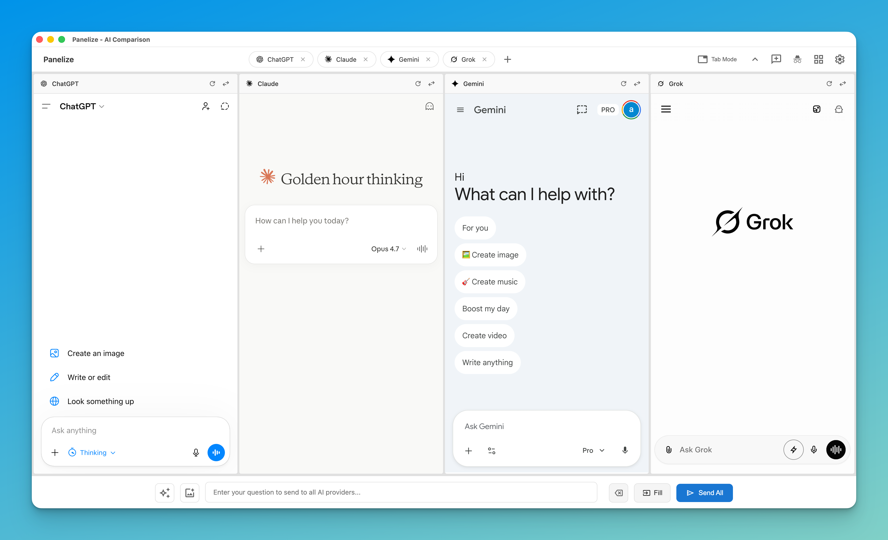
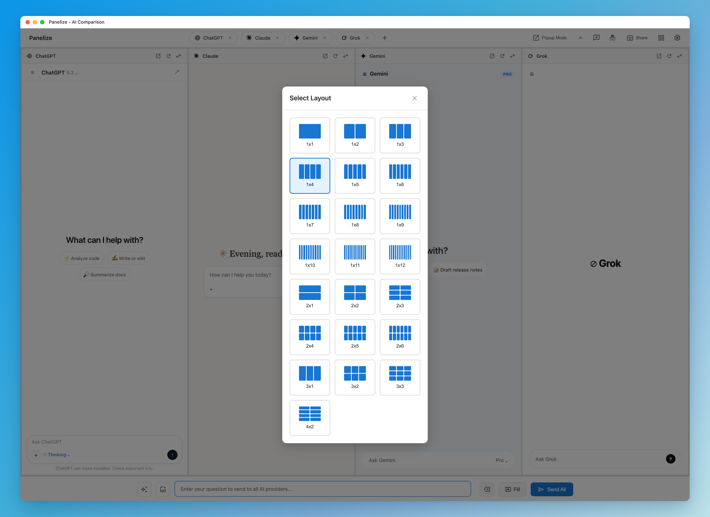
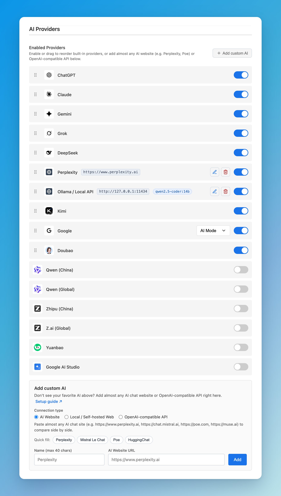

# Panelize

  <a href="README.md"><strong>English</strong></a> |
  <a href="README.zh-CN.md"><strong>简体中文</strong></a> |
  <a href="README.ja.md"><strong>日本語</strong></a>

  
   
  <a href="https://youtu.be/kCRXBVeXbrA">▶ 高画質の動画を見る</a> · <a href="https://panelize.dev">🌐 panelize.dev</a>

  <strong>タブ切り替えをやめて、複数 AI の回答を1画面で比較。</strong>

  
  
  
  
  
  

  

  無料 · API キー不要ですぐ利用可能 · 既存ログインに加えてカスタム AI サイトや API も追加可能 
  Panelize が役に立ったら、GitHub で ⭐ を付けていただけると他の人にも届きやすくなります。

---

## Panelize とは？

Panelize は、1つのプロンプトを ChatGPT、Claude、Gemini、Grok、DeepSeek などの AI チャットに同時に送り、回答を1つのウィンドウで並べて表示する無料・オープンソースの Chrome / Edge 拡張機能です。標準搭載のプロバイダーは公式サイトをそのまま読み込み、普段のログインを使うため、API キーも追加のサブスクリプションも不要です。

さらに、任意の AI チャットサイト（`Perplexity`、`Mistral Le Chat`、`Poe`、`HuggingChat`、`muse.ai`、`Open WebUI` など）や、ローカル・クラウドの OpenAI 互換 API（CORS 設定不要の `Ollama`、`LM Studio`、`vLLM`、`OpenRouter`、`DeepSeek API`）も自由に追加して並べて比較できます。

同じプロンプトを複数の AI タブに貼り付けて比較する作業を、1つの画面にまとめる拡張機能です。

**1つの入力で、複数 AI の回答を同時に比較できます。**

  

---

## 主な機能

### 🎯 1回の入力で同時送信

統一入力欄から ChatGPT / Claude / Gemini / Grok / Doubao / DeepSeek / Kimi / Qwen / Zhipu (China) / Z.ai (Global) / Yuanbao / Google AI Studio / Google、さらに追加したカスタム AI サイトや API パネルへ同時に送信できます。

### 📐 柔軟なレイアウト

22種類のレイアウト（ドラッグで列幅変更可能）を用意。素早い2モデル比較には1×2、最大12モデルの比較には1×12または2×6が使えます。

  

### 🧩 カスタム AI サイト & OpenAI 互換 API

内蔵プロバイダーの更新を待たずに、使いたい AI をそのまま追加できます：
- **任意の AI サイト・セルフホスト Web UI：** `Perplexity`、`Mistral Le Chat`、`Poe`、`HuggingChat`、`muse.ai`、`Open WebUI`、`LibreChat`、`LobeChat` などの URL を貼り付けて、オリジン単位の最小権限で埋め込み可能。
- **OpenAI 互換 API：** ローカルサーバー（CORS 設定不要の `Ollama`、`LM Studio`、`vLLM`）やクラウド API（`OpenRouter`、`DeepSeek API`、`OpenAI`）に接続し、モデル一覧の取得、ストリーミング Markdown / コード表示、画像添付、ローカル専用の API キー保存に対応。
- 詳しい手順は [カスタム AI & API セットアップガイド](https://panelize.dev/guides/add-custom-ai-and-api/) をご覧ください。

### 📸 比較結果を画像として共有

並べた比較結果を1枚の画像（クリップボードへコピー / PNG ダウンロード）として出力できます。プロンプト見出しの編集に対応し、**現在の表示**だけでなく最新プロンプト以降の回答をつなぎ合わせる**回答全体**モードも選べます。

### ⚡ 初期設定不要ですぐ使える

使い始めに API キーは不要です。普段どおり各 AI サービスにログインしていればすぐに利用でき、必要なときだけカスタム AI サイトやローカル / クラウド API を追加できます。

### 📚 Prompt Library

よく使うプロンプトを保存して再利用可能。`{topic}` などの変数にも対応。

### 🔒 プライバシー重視

- 対応プロバイダーでワンクリックの一時チャット / プライバシーモード
- カスタム AI サイト・API はオリジン単位の実行時権限のみを要求
- データ（任意のカスタム API キーを含む）はすべてブラウザ内のみに保存
- トラッキングなし、分析なし
- オープンソース

---

## 対応 AI プロバイダー

### 標準搭載プロバイダー

- ChatGPT
- Claude
- Gemini
- Grok
- Doubao
- DeepSeek
- Kimi
- Qwen（中国版）
- Qwen（グローバル版）
- Zhipu (China)
- Z.ai (Global)
- Yuanbao
- Google AI Studio
- Google

### + カスタム AI サイト & OpenAI 互換 API

**設定 → カスタム AI を追加**（またはパネルの `+` / `⇄` メニュー内の **カスタム AI を追加 / 他のサービス…**）から追加できます：
- **AI サイト：** `Perplexity`、`Mistral Le Chat`、`Poe`、`HuggingChat`、`muse.ai` など
- **ローカル / セルフホスト Web UI：** `Open WebUI`、`LibreChat`、`LobeChat`、`Dify` など
- **OpenAI 互換 API：** `Ollama`（CORS 設定不要）、`LM Studio`、`vLLM`、`OpenRouter`、`DeepSeek API`、`OpenAI` など — [セットアップガイド ↗](https://panelize.dev/guides/add-custom-ai-and-api/)

  

---

## インストール

### Chrome Web Store（推奨）

1. [Chrome Web Store ページ](https://chromewebstore.google.com/detail/panelize/iokalaafkmjffolodkkgbbccmofbglii) を開く
2. **Add to Chrome** をクリック
3. インストール後、`Cmd/Ctrl + Shift + E` で Panelize を開く

> **Edge でも利用可能：** Chrome Web Store からそのままインストールできます。

<strong>手動インストール（開発者向け）</strong>

1. このリポジトリのソースコードをダウンロード
2. `chrome://extensions/`（または `edge://extensions/`）を開く
3. デベロッパーモードを有効化
4. 「パッケージ化されていない拡張機能を読み込む」でフォルダを選択

---

## クイックスタート

1. **各 AI サービスへログイン**（通常のブラウザタブで事前ログイン）
2. **`Cmd/Ctrl + Shift + E` を押す**
3. **レイアウトを選ぶ（または `+` からカスタム AI を追加）**
4. **入力して送信**（全パネルへ同時反映）

---

## キーボードショートカット

| 操作 | ショートカット |
|------|----------------|
| Panelize を開く | `Cmd/Ctrl + Shift + E` |
| Prompt Library を開く | `Cmd/Ctrl + Shift + L` |

`chrome://extensions/shortcuts` で変更できます。

---

## よくある質問

**ChatGPT、Claude、Gemini に同じ質問を一度にするには？**
→ Panelize をインストールし、`Cmd/Ctrl + Shift + E` で開いてプロバイダーとレイアウトを選び、プロンプトを入力して **Send All** をクリックします。回答はそれぞれのパネルに表示されます。

**無料ですか？API キーは必要ですか？**
→ 無料で、MIT ライセンスです。標準搭載プロバイダーやカスタム AI サイトでは API キーは不要で、普段のアカウントでログインしてそのまま使えます（ChatGPT Plus や Claude Pro などの有料プランも利用可能）。クラウドの OpenAI 互換 API（OpenRouter や DeepSeek API など）を追加する場合のみ API キーを使用します（ローカルの Ollama などはキー不要）。

**Perplexity やローカルの Ollama など他の AI サイトを追加できますか？**
→ はい！**設定 → カスタム AI を追加**（またはパネルの `+` / `⇄` メニューの **カスタム AI を追加 / 他のサービス…**）から、**AI サイト**（`Perplexity`、`Mistral Le Chat`、`Poe`、`HuggingChat`、`muse.ai` など）、**ローカル / セルフホスト Web**（`Open WebUI`、`LibreChat`、`LobeChat`）、または **OpenAI 互換 API**（CORS 設定不要の `Ollama`、`LM Studio`、`vLLM`、`OpenRouter`、`DeepSeek API`）を追加できます。詳しくは [セットアップガイド](https://panelize.dev/guides/add-custom-ai-and-api/) をご覧ください。

**ChatHub や ChatALL との違いは？**
→ ChatHub や ChatALL は複数のモデルを1つのチャット画面にまとめます。Panelize は各社の公式サイトをそのまま表示するため、プラン、モデル選択、チャット履歴は各アカウントに残りつつ、カスタム AI サイトや OpenAI 互換 API パネルも並べて比較できます。

## トラブルシューティング

**ログイン画面が表示される場合**
→ 先に通常タブで対象サービスへログインし、Panelize を再読み込みしてください。

**ショートカットが動作しない場合**
→ `chrome://extensions/shortcuts` で競合を確認してください。

**サポートが必要な場合**
→ [Issue を作成](https://github.com/Manho/Panelize/issues)

---

## コントリビューション

コントリビューション歓迎です。

- 🐛 バグ報告
- 💡 機能提案
- 🌍 翻訳の改善
- 🔧 Pull Request

---

## License

MIT License。詳細は [LICENSE](LICENSE) を参照してください。
