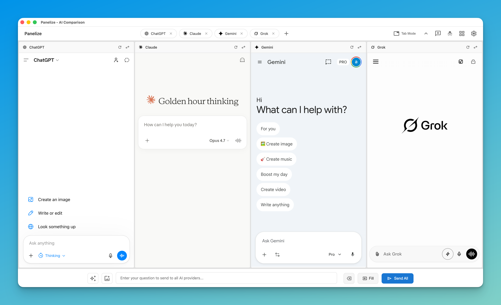
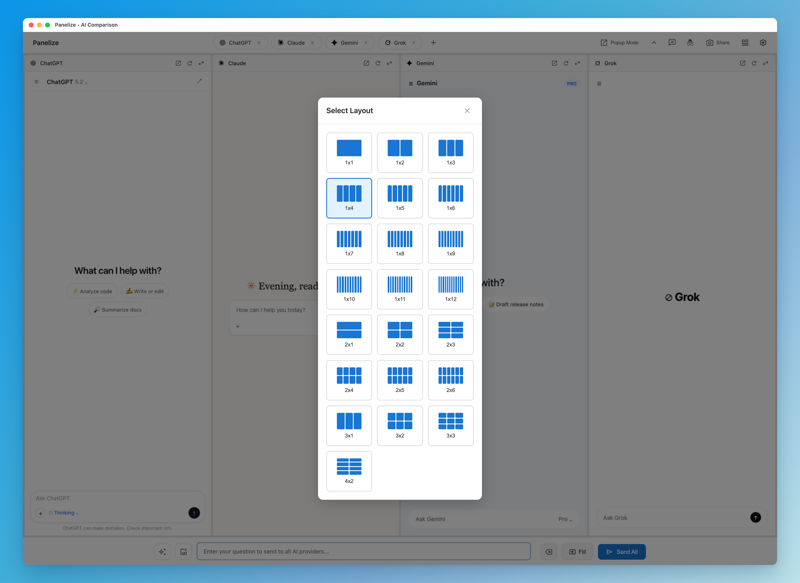
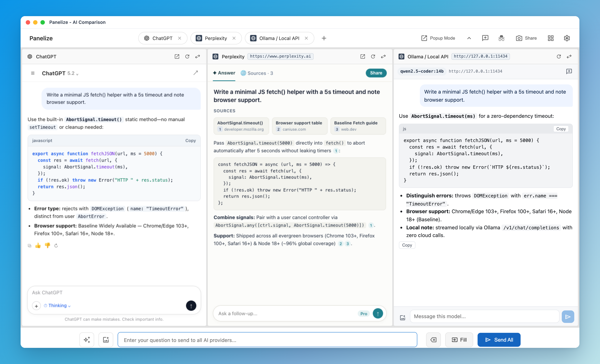
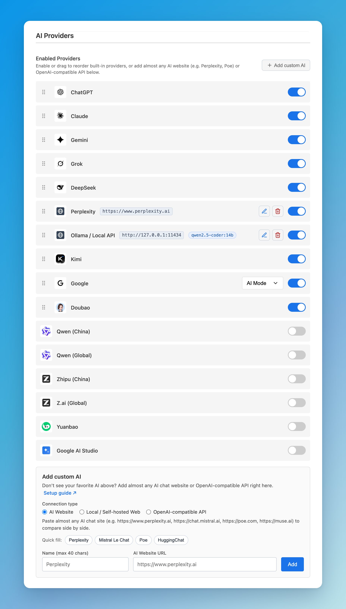

# Panelize

<p align="center">
  <a href="README.md"><strong>English</strong></a> |
  <a href="README.zh-CN.md"><strong>简体中文</strong></a> |
  <a href="README.ja.md"><strong>日本語</strong></a>
</p>

<p align="center">
  
  <br>
  <a href="https://youtu.be/kCRXBVeXbrA">▶ Watch the HD video</a> · <a href="https://panelize.dev">🌐 panelize.dev</a>
</p>

<p align="center">
  <strong>Stop switching tabs. Start comparing AI responses side by side.</strong>
</p>

<p align="center">
  <a href="https://chromewebstore.google.com/detail/panelize/iokalaafkmjffolodkkgbbccmofbglii"></a>
  <a href="https://chromewebstore.google.com/detail/panelize/iokalaafkmjffolodkkgbbccmofbglii"></a>
  <a href="https://chromewebstore.google.com/detail/panelize/iokalaafkmjffolodkkgbbccmofbglii"></a>
  <a href="https://github.com/Manho/Panelize/stargazers"></a>
  
  
</p>

<p align="center">
  <a href="https://chromewebstore.google.com/detail/panelize/iokalaafkmjffolodkkgbbccmofbglii"></a>
</p>

<p align="center">
  <sub>Free · No API keys required · Works with your existing AI logins + custom AI sites &amp; APIs</sub><br>
  <sub>If Panelize saves you time, a ⭐ on GitHub helps other people find it.</sub>
</p>

---

## Why Panelize?

Panelize is a free, open-source Chrome and Edge extension that sends one prompt to ChatGPT, Claude, Gemini, Grok, DeepSeek and other AI chatbots at the same time and shows their answers side by side in one window. Out of the box, it loads each provider's real website with your existing login—no API keys and no extra subscription required.

Want even more? You can also add almost any AI chat website (`Perplexity`, `Mistral Le Chat`, `Poe`, `HuggingChat`, `muse.ai`, `Open WebUI`) or connect local and cloud OpenAI-compatible APIs (`Ollama` with zero CORS setup, `LM Studio`, `vLLM`, `OpenRouter`, `DeepSeek API`) right alongside your built-in panels.

Ever found yourself copying the same prompt across multiple AI tabs just to compare answers? Panelize eliminates that workflow entirely.

**One window. One prompt. Multiple AI responses—instantly.**

<p align="center">
  
</p>

---

## Features at a Glance

### 🎯 Ask Once, Compare All

Type your question once and send it to ChatGPT, Claude, Gemini, Grok, Doubao, DeepSeek, Kimi, Qwen, Zhipu (China), Z.ai (Global), Yuanbao, Google AI Studio, Google, and your own custom AI sites or APIs simultaneously. See which AI gives you the best answer—no tab switching required.

### 📐 Flexible Layouts

Choose from 22 different layouts (with draggable resizable columns) to fit your workflow. Need a quick 2-way comparison? Use 1×2. Deep research across 12 models? Try 1×12 or 2×6. The choice is yours.

<p align="center">
  
</p>

### 🧩 Custom AI Websites & OpenAI-Compatible APIs

Don't wait for a built-in update to try a new model or service:
- **Any AI Website or Self-Hosted Web UI:** Paste URLs such as `Perplexity`, `Mistral Le Chat`, `Poe`, `HuggingChat`, `muse.ai`, `Open WebUI`, `LibreChat`, or `LobeChat` with scoped per-origin permissions and generic composer support.
- **OpenAI-Compatible APIs:** Connect local servers (`Ollama` works out of the box with zero CORS setup, `LM Studio`, `vLLM`) or cloud endpoints (`OpenRouter`, `DeepSeek API`, `OpenAI`) with one-click model loading, streaming Markdown/code rendering, image attachments, and local-only API key storage.
- Read the [Custom AI & API Setup Guide](https://panelize.dev/guides/add-custom-ai-and-api/) for step-by-step examples.

<p align="center">
  
</p>

### 📸 Share Comparison as Image

Turn any multi-model comparison into a clean, shareable image to copy to your clipboard or download as PNG, complete with an editable prompt header. Capture the **Current view** or stitch **Full answers** from your latest prompt down.

### ⚡ Zero Setup Out of the Box

No API keys required to start. Log into your favorite AI websites normally and Panelize uses your existing browser sessions—then add custom AI sites or local/cloud APIs only if and when you want them.

### 📚 Prompt Library

Save your best prompts and reuse them across all providers. Supports variables like `{topic}` for quick customization.

### 🔒 Privacy First

- One-click privacy mode across supported providers
- Scoped per-origin runtime permissions when adding custom AI websites or APIs
- All data (including optional custom API keys) stays in local browser storage—nothing is sent to Panelize servers
- No tracking, no analytics, no data collection
- Open source—review the code yourself

---

## Supported AI Providers

### Built-in Providers

<table align="center">
  <tr>
    <td align="center"><strong>ChatGPT</strong></td>
    <td align="center"><strong>Claude</strong></td>
    <td align="center"><strong>Gemini</strong></td>
    <td align="center"><strong>Grok</strong></td>
  </tr>
  <tr>
    <td align="center"><strong>Doubao</strong></td>
    <td align="center"><strong>DeepSeek</strong></td>
    <td align="center"><strong>Kimi</strong></td>
    <td align="center"><strong>Google</strong></td>
  </tr>
  <tr>
    <td align="center"><strong>Qwen (China)</strong></td>
    <td align="center"><strong>Qwen (Global)</strong></td>
    <td align="center"><strong>Zhipu (China)</strong></td>
    <td align="center"><strong>Z.ai (Global)</strong></td>
  </tr>
  <tr>
    <td align="center"><strong>Yuanbao</strong></td>
    <td align="center"><strong>Google AI Studio</strong></td>
    <td></td>
    <td></td>
  </tr>
</table>

### + Custom AI Websites & OpenAI-Compatible APIs

Add in **Settings → Add custom AI** (or click **Add custom AI / More providers…** inside any `+` or `⇄` panel menu):
- **AI Websites:** `Perplexity`, `Mistral Le Chat`, `Poe`, `HuggingChat`, `muse.ai`, and other web chat apps
- **Local / Self-hosted Web UIs:** `Open WebUI`, `LibreChat`, `LobeChat`, `Dify`, LAN/team chat portals
- **OpenAI-Compatible APIs:** `Ollama` (zero CORS setup), `LM Studio`, `vLLM`, `OpenRouter`, `DeepSeek API`, `OpenAI`, and any `/v1/chat/completions` service — [Setup guide ↗](https://panelize.dev/guides/add-custom-ai-and-api/)

<p align="center">
  
</p>

---

## Installation

### Chrome Web Store (Recommended)

1. Visit the [Chrome Web Store](https://chromewebstore.google.com/detail/panelize/iokalaafkmjffolodkkgbbccmofbglii) page
2. Click **"Add to Chrome"**
3. Done! Press `Cmd/Ctrl + Shift + E` to open Panelize

> **Works on Edge too:** Install directly from the Chrome Web Store.

<details>
<summary><strong>Manual Installation (for developers)</strong></summary>

1. Download the source code from this repository
2. Go to `chrome://extensions/` (or `edge://extensions/`)
3. Enable "Developer mode"
4. Click "Load unpacked" and select the extracted folder

</details>

---

## Quick Start

1. **Log into your AI accounts** — Visit ChatGPT, Claude, etc. and log in as usual
2. **Press `Cmd/Ctrl + Shift + E`** — Opens the Panelize window
3. **Pick a layout (or add custom AIs)** — Choose your panels, or click `+` → **Add custom AI / More providers…** to add Perplexity, Ollama, OpenRouter, and more
4. **Type and send** — Your prompt goes to all panels at once

That's it. No accounts to create, no API keys required to get started.

---

## Keyboard Shortcuts

| Action | Shortcut |
|--------|----------|
| Open Panelize | `Cmd/Ctrl + Shift + E` |
| Open Prompt Library | `Cmd/Ctrl + Shift + L` |

Customize shortcuts at `chrome://extensions/shortcuts`

---

## FAQ

**How do I ask ChatGPT, Claude and Gemini the same question at once?**
→ Install Panelize, open it with `Cmd/Ctrl + Shift + E`, pick the providers and a layout, type your prompt and click **Send All**. Each answer appears in its own panel.

**Is Panelize free? Do I need API keys?**
→ Yes, Panelize is free and MIT-licensed. No API keys are needed for built-in AI chatbots or custom AI websites: each panel loads the provider's own website with your normal account (paid plans such as ChatGPT Plus or Claude Pro work as usual). API keys are only used if you optionally connect a cloud OpenAI-compatible API endpoint (such as OpenRouter or DeepSeek API), and local servers like Ollama need no key at all.

**Can I add Perplexity, local Ollama, or other AI sites?**
→ Yes! Open **Settings → Add custom AI** (or click **Add custom AI / More providers…** in the `+` or `⇄` panel menu) and choose **AI Website** (e.g. `Perplexity`, `Mistral Le Chat`, `Poe`, `HuggingChat`, `muse.ai`), **Local / Self-hosted Web** (`Open WebUI`, `LibreChat`, `LobeChat`), or **OpenAI-compatible API** (`Ollama` with zero CORS configuration, `LM Studio`, `vLLM`, `OpenRouter`, `DeepSeek API`). See the [Custom AI & API Setup Guide](https://panelize.dev/guides/add-custom-ai-and-api/).

**How is Panelize different from ChatHub or ChatALL?**
→ ChatHub and ChatALL put many models behind one chat interface. Panelize shows each provider's real website so you keep your own plans, model pickers and chat history—while also letting you mix in custom AI websites and OpenAI-compatible API panels side by side. See [Panelize vs ChatHub](https://panelize.dev/alternatives/chathub/).

**Which AI chatbots are supported?**
→ Built-in support includes ChatGPT, Claude, Gemini, Grok, DeepSeek, Kimi, Qwen, Doubao, Zhipu, Z.ai, Yuanbao, Google AI Studio and Google AI Mode, plus custom AI chat websites and OpenAI-compatible APIs. See [Supported AI Providers](#supported-ai-providers).

## Troubleshooting

**AI provider shows login page?**
→ Log into that provider in a regular browser tab first, then refresh Panelize.

**Shortcuts not working?**
→ Check for conflicts at `chrome://extensions/shortcuts`

**Qwen (Global) looks logged out after signing in?**
→ In Settings, enable Qwen (Global) and approve access to both `chat.qwen.ai` and `auth.qwen.ai`, then reload the panel. Existing users may need to approve the added authentication origin after updating Panelize. If Qwen has already invalidated the session, sign in again on its website first.

**Need more help?**
→ [Open an issue](https://github.com/Manho/Panelize/issues)

---

## Development and Testing

```bash
npm install
npx playwright install chromium   # browser used by the e2e and live suites
```

With Playwright 1.58, `npx playwright install` can hang while it extracts the download under Node 26. The install then stays incomplete. If that happens, stop it and run the install once with Node 24 (for example `nvm exec 24 npx playwright install chromium`). The e2e suite then uses the installed browser under any Node version.

| Command | What it runs |
| --- | --- |
| `npm test` | Unit and integration tests (Vitest + happy-dom) |
| `npm run test:e2e` | Extension e2e tests: the real extension against local fixture sites, headless and in parallel |
| `npm run test:e2e:headed` | Same, with visible windows for debugging (or set `PANELIZE_E2E_HEADED=1`) |
| `npm run test:live:login` | Opens the live-test profile in a normal browser window so you can log in to providers |
| `npm run test:live` | Smoke checks against the real provider sites (manual, not part of CI) |

### Live smoke tests

The live suite catches provider site changes that fixtures cannot. For each provider it opens the real multi-panel page, types into the unified input, and presses **Fill**. It then checks that the text reached the provider's composer and that the send and new-chat selectors still match. Without `PANELIZE_LIVE_SEND` it then clears the composer and reloads the panel to confirm that no test text stays behind as a saved draft. A provider whose composer already holds a draft of yours is skipped, so the test never touches your text.

1. Run `npm run test:live:login` and log in to each provider. If a panel still looks logged out, log in inside that panel on the multi-panel tab, because panel iframes use partitioned storage. Quit the browser when you are done (Cmd+Q on macOS); with more than 12 providers the next batch then opens. The logins are kept in the profile, so this is a one-time step.
2. Run `npm run test:live`, ideally before every release. By default it opens a visible window, because several sites block headless browsers.
3. Failures save a screenshot and the provider frame's HTML under `test-results/live/`.

| Variable | Default | Meaning |
| --- | --- | --- |
| `PANELIZE_LIVE_PROFILE` | `~/.panelize-live-profile` | Profile directory that keeps the logins |
| `PANELIZE_LIVE_PROVIDERS` | all providers | Comma-separated ids, e.g. `chatgpt,doubao` |
| `PANELIZE_LIVE_SEND` | off | `1` actually sends the prompt, which uses provider quota |
| `PANELIZE_LIVE_HEADLESS` | off | `1` runs headless; expect Cloudflare challenges on some sites |

---

## Contributing

Found a bug? Have an idea? Contributions are welcome:
- 🐛 Report bugs via [GitHub Issues](https://github.com/Manho/Panelize/issues)
- 💡 Suggest features
- 🌍 Help translate to more languages
- 🔧 Submit pull requests

---

## License

MIT License — see [LICENSE](LICENSE) for details.

---

<p align="center">
  <strong>Open source & privacy-focused</strong><br>
  Available in 10 languages
</p>

<p align="center">
  <sub>Made for everyone who's tired of tab-switching between AI assistants.</sub>
</p>
