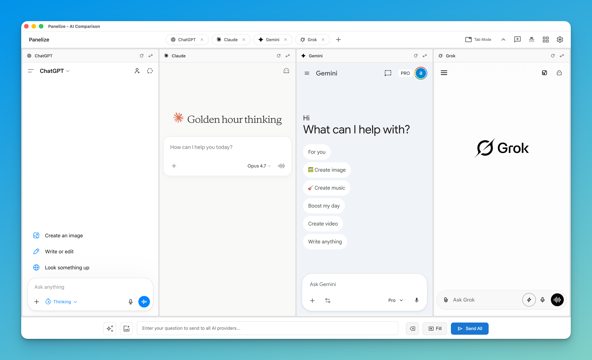
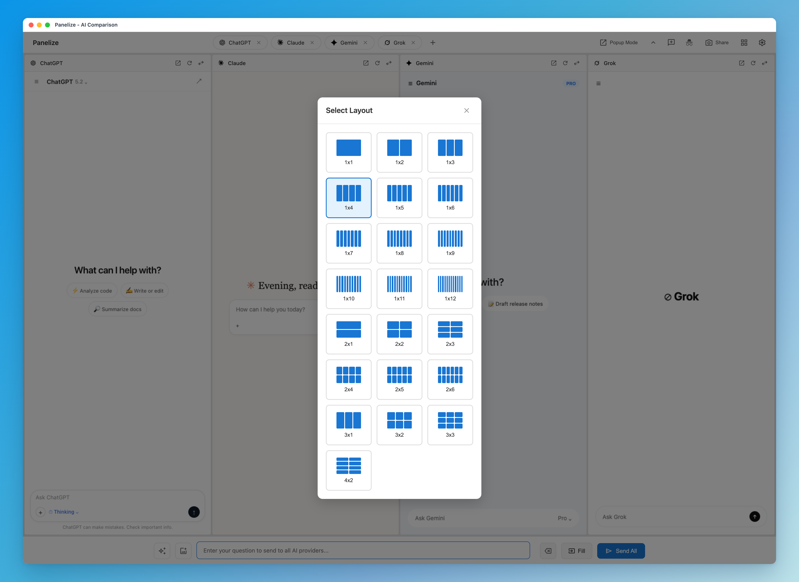
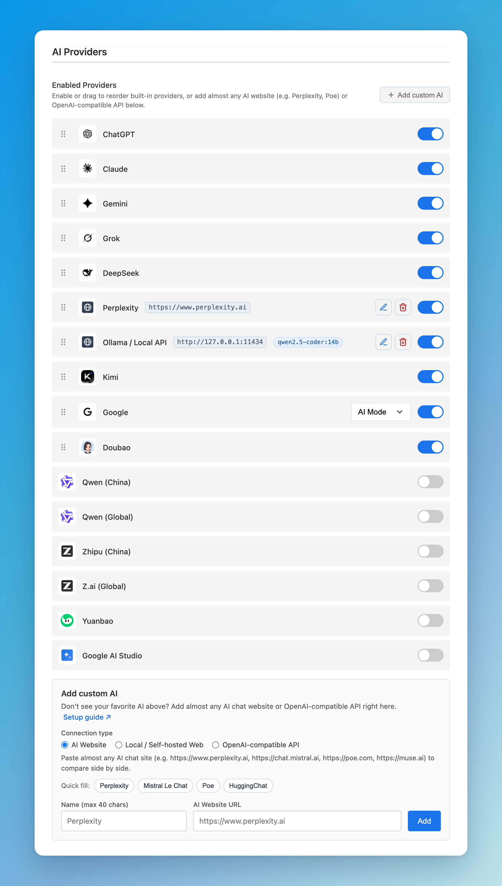

# Panelize

  <a href="README.md"><strong>English</strong></a> |
  <a href="README.zh-CN.md"><strong>简体中文</strong></a> |
  <a href="README.ja.md"><strong>日本語</strong></a>

  
   
  <a href="https://youtu.be/rL9m86Z4f9Y">▶ 观看高清视频</a> · <a href="https://panelize.dev/zh/">🌐 官网panelize.dev</a>

  <strong>告别反复切换标签页，一次提问并排对比多个AI回答。</strong>

  
  
  
  
  
  

  

  免费 · 无需API Key即可开箱使用 · 直接复用已登录AI账号，支持自定义AI网站与API 
  如果Panelize帮你省了时间，点个 ⭐ 能让更多人看到它。

---

## 为什么选择Panelize？

Panelize是一个免费、开源的Chrome / Edge扩展：一次输入，同时发给ChatGPT、Claude、Gemini、DeepSeek、Kimi、豆包等AI，并在同一个窗口里并排显示它们的回答。内置平台直接加载官方网站、复用你已登录的账号，无需API Key，也不用额外订阅。

想接入更多模型？你还可以随时添加几乎任意AI对话网站（`Perplexity`、`Mistral Le Chat`、`Poe`、`HuggingChat`、`muse.ai`、秘塔、`Open WebUI`）或本地/云端OpenAI兼容API（`Ollama`免配CORS跨域直连、`LM Studio`、`vLLM`、`OpenRouter`、`DeepSeek API`），与内置面板同屏对比。

还在把同一个Prompt复制到多个AI标签页里逐个比较吗？

**Panelize让你在一个窗口里，一次发送，直接横向对比多个AI的答案。**

  

---

## 核心功能

### 🎯 一次提问，同时对比

在统一输入框中输入一次内容，就能同时发送到ChatGPT、Claude、Gemini、Grok、Doubao、DeepSeek、Kimi、Qwen、Zhipu (China)、Z.ai (Global)、元宝、Google AI Studio、Google，以及你添加的自定义AI网站或API面板。

### 📐 灵活布局

支持22种布局并可拖拽调整列宽。快速双模型对比可用1×2，最多可用1×12或2×6同时对比12个模型。

  

### 🧩 自定义AI网站与OpenAI兼容API

无需等待扩展更新，随时接入你想用的AI服务：
- **任意AI网站与本地/自建网页端：** 直接粘贴`Perplexity`、`Mistral Le Chat`、`Poe`、`HuggingChat`、`muse.ai`、秘塔、`Open WebUI`、`LibreChat`、`LobeChat`等地址，按域名最小权限授权并支持通用输入框发送。
- **OpenAI兼容API：** 直连本地模型服务（`Ollama`免配CORS开箱即连、`LM Studio`、`vLLM`）或云端接口（`OpenRouter`、`DeepSeek API`、硅基流动等），支持一键拉取模型列表、流式Markdown/代码渲染、图片附件与仅存本地的API Key。
- 详细配置步骤请查看[自定义AI与API接入指南](https://panelize.dev/zh/guides/add-custom-ai-and-api/)。

### 📸 分享对比图片

支持将多模型并排回答一键导出为高清对比图（复制到剪贴板或下载PNG），可编辑顶部提问标题，并支持**当前视图**或自动拼接完整回答的**完整回答**模式。

### ⚡ 开箱零配置

内置平台无需API Key，也不需要注册额外账号——在浏览器里正常登录各家AI官网即可使用；需要更多平台或本地模型时再按需添加自定义AI或API。

### 📚 Prompt Library

可保存常用提示词，并支持`{topic}`这类变量占位符，复用更高效。

### 🔒 隐私优先

- 支持在兼容的平台上一键开启临时/隐私对话
- 自定义AI网站与API均采用按源（per-origin）运行时最小权限授权
- 所有数据（含可选的自定义API Key）仅保存在本地浏览器，不经过任何Panelize服务器
- 无追踪、无埋点、无数据上传
- 完全开源，可自行审阅代码

---

## 支持的AI平台

### 内置平台（14个）

- ChatGPT
- Claude
- Gemini
- Grok
- Doubao
- DeepSeek
- Kimi
- Qwen（中国版）
- Qwen（海外版）
- Zhipu (China)
- Z.ai (Global)
- 元宝
- Google AI Studio
- Google

### + 自定义AI网站与OpenAI兼容API

在**设置 → 添加自定义AI**（或面板工具栏`+` / `⇄`菜单底部的**添加自定义AI / 更多平台…**）中直接添加：
- **AI网站：** `Perplexity`、`Mistral Le Chat`、`Poe`、`HuggingChat`、`muse.ai`、秘塔等对话网站
- **本地/自建网页端：** `Open WebUI`、`LibreChat`、`LobeChat`、`Dify`等本机或团队自建界面
- **OpenAI兼容API：** `Ollama`（免配CORS）、`LM Studio`、`vLLM`、`OpenRouter`、`DeepSeek API`等兼容`/v1/chat/completions`的服务 — [查看接入指南 ↗](https://panelize.dev/zh/guides/add-custom-ai-and-api/)

  

---

## 安装

### Chrome Web Store（推荐）

1. 打开[Chrome Web Store页面](https://chromewebstore.google.com/detail/panelize/iokalaafkmjffolodkkgbbccmofbglii)
2. 点击**Add to Chrome**
3. 安装完成后按`Cmd/Ctrl + Shift + E`打开Panelize

> **Edge也可用：** 可直接从Chrome Web Store安装。

<strong>手动安装（开发者）</strong>

1. 下载本仓库源码
2. 打开`chrome://extensions/`（或`edge://extensions/`）
3. 开启“开发者模式”
4. 点击“加载已解压的扩展程序”，选择项目目录

---

## 快速开始

1. **先登录各平台账号**：先在普通网页标签页登录ChatGPT / Claude等
2. **按`Cmd/Ctrl + Shift + E`**：打开Panelize
3. **选择布局或添加自定义AI**：按需求选择面板数量与布局，也可点`+` → **添加自定义AI / 更多平台…**接入Perplexity、Ollama、OpenRouter等
4. **输入并发送**：一次发送到所有面板

---

## 快捷键

| 操作 | 快捷键 |
|------|--------|
| 打开Panelize | `Cmd/Ctrl + Shift + E` |
| 打开Prompt Library | `Cmd/Ctrl + Shift + L` |

可在`chrome://extensions/shortcuts`自定义。

---

## 常见问题

**怎样同时问ChatGPT、Claude和DeepSeek同一个问题？**
→ 安装Panelize，按`Cmd/Ctrl + Shift + E`打开，选好AI和布局，输入问题后点**Send All**，每个AI的回答会显示在各自的面板里。

**Panelize免费吗？需要API Key吗？**
→ 免费，MIT开源。内置平台和自定义AI网站都不需要API Key：每个面板就是官方网站，直接使用你平时登录的账号，ChatGPT Plus、Claude Pro等付费套餐照常可用。只有在你主动接入云端OpenAI兼容API（如OpenRouter、DeepSeek API）时才需要填写对应服务的API Key（仅保存在浏览器本地）；本地Ollama等服务无需API Key。

**可以添加Perplexity、本地Ollama或其他AI网站吗？**
→ 可以！打开**设置 → 添加自定义AI**（或在面板`+` / `⇄`菜单中点击**添加自定义AI / 更多平台…**），选择**AI网站**（如`Perplexity`、`Mistral Le Chat`、`Poe`、`HuggingChat`、`muse.ai`）、**本地/自建网页端**（如`Open WebUI`、`LibreChat`、`LobeChat`）或**OpenAI兼容API**（`Ollama`免配跨域直连、`LM Studio`、`vLLM`、`OpenRouter`、`DeepSeek API`）即可。详见[自定义AI与API接入指南](https://panelize.dev/zh/guides/add-custom-ai-and-api/)。

**和ChatHub、ChatALL有什么区别？**
→ ChatHub和ChatALL是把多个模型接到同一个聊天界面里；Panelize直接显示各家官网，保留你的订阅套餐、模型选择和聊天记录，同时还支持将自定义AI网站和OpenAI兼容API面板混排对比。

**AI页面显示登录状态？**
→ 先在普通标签页登录该平台，再刷新Panelize。

**快捷键无效？**
→ 到`chrome://extensions/shortcuts`检查冲突。

**需要帮助？**
→ [提交Issue](https://github.com/Manho/Panelize/issues)

---

## 贡献

欢迎反馈与贡献：

- 🐛 提交Bug
- 💡 提出功能建议
- 🌍 参与更多语言翻译
- 🔧 提交Pull Request

---

## License

MIT License，详见[LICENSE](LICENSE)。
